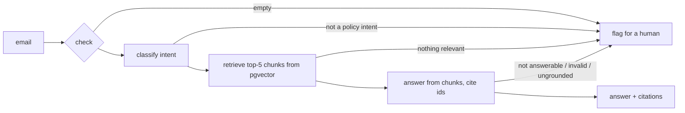

# mailmind-rag

Email triage with retrieval-augmented answers, built in Node.js and TypeScript, with an eval harness that measures every change.

A customer email arrives at a fake store, **Northwind Goods**. The system classifies the intent. If the email is about a policy (returns, shipping, discounts and so on), it searches the policy PDFs and writes an answer that cites the passages it used. Anything else, or any answer it cannot back with a passage, is flagged for a human instead of guessed.

The point of the project is the measurement. There is a labeled email set, an 80-question Q&A set, a one-command eval, recorded baseline numbers, and improvements applied one at a time, each followed by an eval re-run. Tests fail if a metric drops. Everything runs locally on a small model (`llama3.1:8b` through Ollama), so the numbers are for a weak model, which makes the failures easy to see.

## How it works



The flow is a [LangGraph.js](https://github.com/langchain-ai/langgraphjs) graph (`src/application/triageGraph.ts`): `check`, `classify`, `retrieve`, `answer`, and one `flag` exit.

- **Classify.** One of ten intents plus a self-reported confidence. Six intents are answerable from the policies; the rest need order or payment data and go to a human.
- **Retrieve.** Seven policy PDFs are chunked by heading (45 chunks), embedded with `nomic-embed-text` and stored in Postgres with pgvector. The raw email text is the query.
- **Answer.** The model first says whether the retrieved text answers the question, then writes the answer. Code then checks the reply: valid JSON, at least one real citation, and no number that is not in the cited text. Any failure is a refusal that flags the email.
- **Swappable parts.** The model, the embedder and the store sit behind small interfaces (`src/application/ports.ts`), so changing the model changes nothing else.

## Results

Baseline recorded on 2026-11-06, after the pipeline worked end to end; "now" is 2026-11-11 after three prompt changes and one retrieval change. Same data, same model.

| Metric | Baseline | Now |
|---|---|---|
| Intent accuracy, 54 labeled emails (12 deliberately messy) | 49/54 = 90.7% | 51/54 = 94.4% |
| Right policy chunk retrieved, 64 answerable questions | 53/64 = 82.8% | 60/64 = 93.8% |
| Multi-chunk questions with every needed chunk retrieved | 5/11 | 7/11 |
| Unanswerable questions correctly refused (16) | 16/16 | 16/16 |
| Answerable questions answered instead of refused | 58/64 = 90.6% | 54/64 = 84.4% |
| Answers that cite a correct source | 47/58 = 81.0% | 47/54 = 87.0% |
| Answers of three words or fewer | 39 of 58 | 0 of 54 |
| Answers the fact check marks wrong | 5 | 4 |
| **Answers correct (estimate, see below)** | **50/64 = 78%** | **47/64 = 73%** |

What changed, one step each (full numbers in [eval/experiments.md](eval/experiments.md)):

1. **Answer prompt v2.** Asking for full sentences alone made the model answer everything, including questions the policies cannot answer (refusals fell from 16/16 to 5/16). Making the model decide `answerable` first restored 16/16 and removed the one-word answers, at the cost of refusing six answerable questions it used to answer.
2. **Retrieval k=5, cutoff 0.55.** Chosen with an offline sweep of 20 settings, no model calls. The cutoff itself barely separates answerable from unanswerable: 14 of 16 unanswerable questions pass even 0.6, so refusal depends on the model's flag, not on retrieval.
3. **Classification prompt v2.** Intent definitions and a "classify the current request" rule fixed all five old misses and introduced three new ones.
4. **Answer prompt v3.** Asking for every used chunk to be cited raised correct citations by 4.9 points, with two fewer answered questions. A mixed result on one run.

**Answer correctness did not improve.** I read by hand every answer the fact check could not judge (14 at the baseline, 20 now) and assumed the answers it confirmed are right (6 of 6 were when I sampled them at the baseline; I did not sample any this time). Baseline: 50 right, 3 partly, 5 wrong, 6 refused. Now: 47 right, 2 partly, 5 wrong, 10 refused. The changes fixed the format (no more one-word answers), retrieval and citations, but they moved four answerable questions from answered to refused, and the number of wrong answers stayed at 5. The stricter model gate trades coverage for safety; it did not make the answers it gives more often correct.

## Evaluation

`npm run eval` runs both evals and writes dated files to `results/`:

- **Classification.** Accuracy per file, a confusion matrix, and confidence calibration (is "90" right about 90% of the time?).
- **Q&A.** Retrieval hit rate with and without the similarity cutoff, refusal accuracy, citation accuracy, and a fact check on each answer.
- **Fact check.** A cheap screen that marks an answer *wrong* if its yes/no is flipped or its numbers all differ from the expected answer, *confirmed* if they match, and otherwise leaves it for a human. It is not a judge.

`npm test` also runs a regression test that reads the newest saved results and fails if a metric is below its floor in [eval/thresholds.json](eval/thresholds.json), or if a prompt or retrieval setting changed since the results were saved.

## Run it

You need Node 20+, Ollama, and Postgres with the pgvector extension.

```bash
ollama pull llama3.1:8b
ollama pull nomic-embed-text
npm install
cp .env.example .env        # set DATABASE_URL
npm run db:init             # creates the chunks table
npm run index               # chunks the PDFs, embeds them, stores them
npm run dev                 # http://localhost:3000
```

- `/` is the triage page: paste an email and see each stage and the final result.
- `/question.html` is the search and Q&A page.
- `POST /triage/email` takes `{ "subject": "...", "body": "..." }`.
- `npm run eval`, `npm test`, `npm run typecheck`.

CI runs the typecheck and the unit tests on Node 20 and 24. It has no Ollama or Postgres, so it does not run the eval; the regression test checks the committed results instead.

## Layout

```
src/domain/          parsing, validation, chunking, scoring (no dependencies)
src/application/     use cases, prompts, the triage graph, ports
src/infrastructure/  Ollama adapters, pgvector store, PDF reader
src/presentation/    Express API
scripts/             indexing, eval runners, the retrieval sweep
eval/                Q&A set, thresholds, experiment log, failure causes
kb/                  fact sheets, generated policies, PDFs
```

[PROJECT.md](PROJECT.md) has the full explanation, and [eval/failure-causes.md](eval/failure-causes.md) sorts every baseline failure by cause.

## Limitations

- **Small, synthetic data.** The eval has 54 emails and 80 questions, so one email moves accuracy by 1.9 points. The policies were written by a local model from fact sheets, and the Q&A set was drafted by a model and then checked, so the numbers show behavior on documents like these, not on a real store.
- **One model, one run.** Results come from `llama3.1:8b` at temperature 0. The Q&A runs matched exactly across two runs; classification matched across three. A different Ollama or model version can change them.
- **The fact check is shallow.** About a third of answers cannot be judged by it, so correctness needs human reading. The correctness figures above rest on reading those answers and on an assumption about the rest, so they are estimates, not counts.
- **Over-refusal.** The model now refuses ten answerable questions. That is the safe direction (a human sees them) but it lowers coverage.
- **Known failures.** The model compares numbers badly in some cases (a 2-hour-old link against a 60-minute window), four questions never retrieve their chunk, and the cutoff does not separate answerable from unanswerable.
- **Confidence is self-reported.** The model's 0-100 score is not calibrated; after the classification change it says 90 or more on almost every email.
- **Scope.** No attachment or receipt extraction, no authentication on the API, and the graph is rebuilt on every request. It is a demo of the pipeline and the measurement, not a production service.
